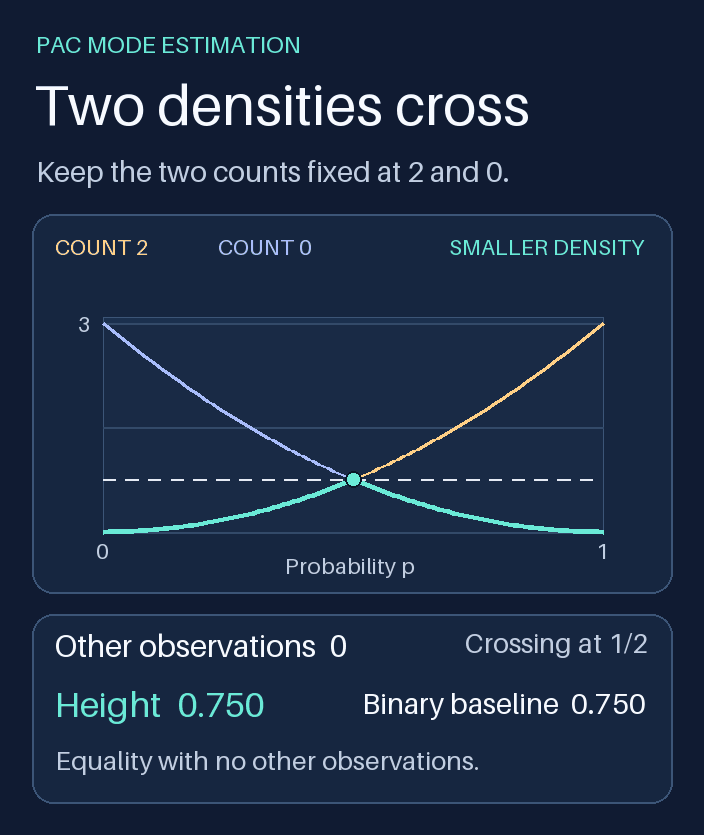

# A sharp beta-density inequality for PAC mode estimation

   

At the interior crossing of the beta densities for two counts, their common height is at least the corresponding binary density at 1/2. The factor 1 is sharp and strengthens the AISTATS 2022 conjecture. The proof covers a zero runner-up count.

[Read the paper](paper/manuscript.pdf) · [LaTeX source](paper/manuscript.tex) · [Proof outline](proof/PROBLEM_AND_PROOF.md) · [Run the replay](REPRODUCIBILITY.md)

## Two densities, one crossing

With counts 2 and 0 and no other observations, the curves cross at 1/2 with height 3/4. With seven other observations, the crossing moves to 1/7 and the common height becomes 10(6/7)⁹. The theorem explains why the common height is strictly above the fixed binary baseline whenever other observations are present.

[Download the offline explorer](https://raw.githubusercontent.com/DannyExperiments/sharp-beta-density-crossing/refs/tags/v1.0.0/visualization/beta-crossing-explorer.zip), extract it, and open `index.html`. Change the total and rotate the curves. [Figure guide](visualization/README.md)

## Consequence for PAC stopping

For the original uniform-prior PPR rules, if PPR-1vr stops on a sample path then PPR-1v1 has stopped by the same time. The proof fills the density-bound step that Anand Jain et al. left conjectural in Appendix C.2.

[Exact question](https://proceedings.mlr.press/v151/anand-jain22a/anand-jain22a.pdf#page=19) · [Pinned Q950](https://github.com/10m-u/open-problems-catalog/blob/ca8d4d44ba3db527f19f28928c240168f545ecfe/problems/mathematics/mathematical-statistics.md#q950)

[Mathematical audit](audits/public_safe_reports/MATHEMATICAL_AUDIT.md) · [Literature audit](audits/public_safe_reports/LITERATURE_AUDIT.md) · [Scope](CLAIM_SCOPE_AND_LIMITATIONS.md) · [AI disclosure](AI_DISCLOSURE.md) · [Status](STATUS.md)

[Release v1.0.0](https://github.com/DannyExperiments/sharp-beta-density-crossing/releases/tag/v1.0.0) · [Version DOI](https://doi.org/10.5281/zenodo.24572899) · [Citation](CITATION.cff)

## Partial Lean verification

For positive rational A and B and every positive integer exponent d, the reduced beta kernels A·pᵈ and B·(1−p)ᵈ have at most one crossing in rational 0<p<1. The proof uses strict power monotonicity on both sides. [Scope, source and replay](formalization/README.md)
